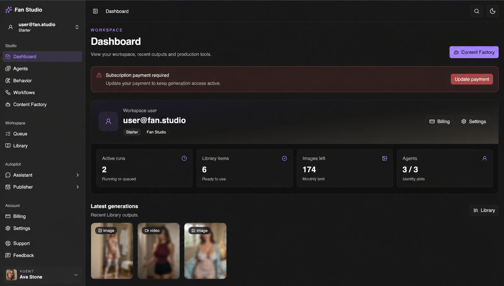
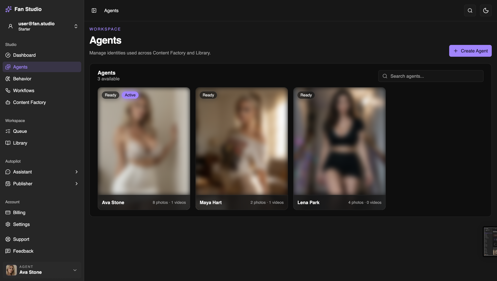
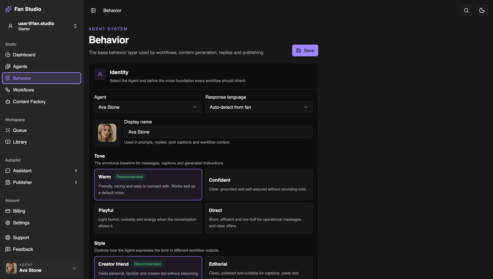
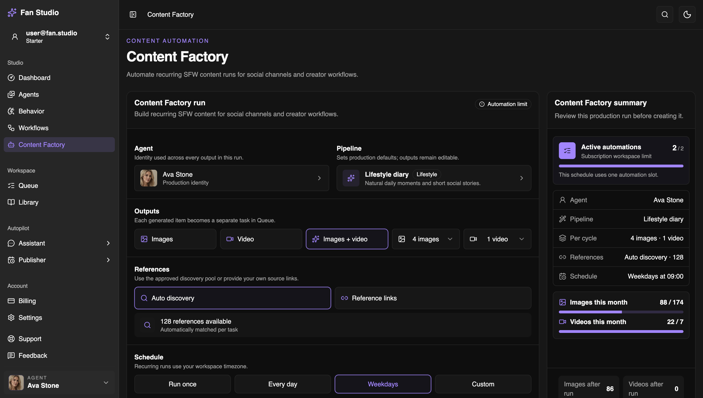
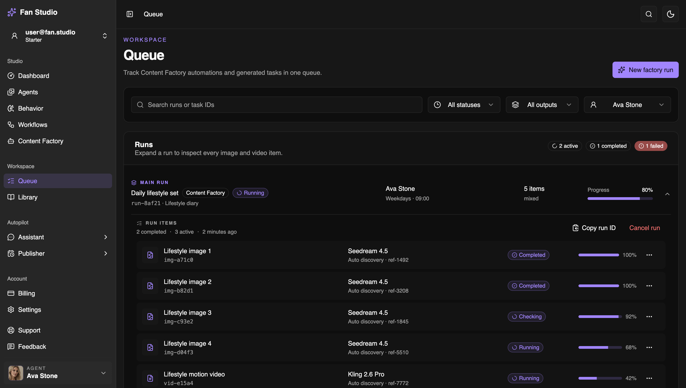
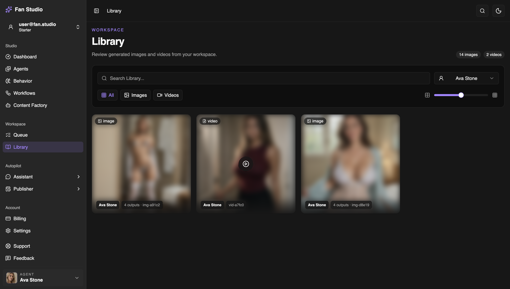
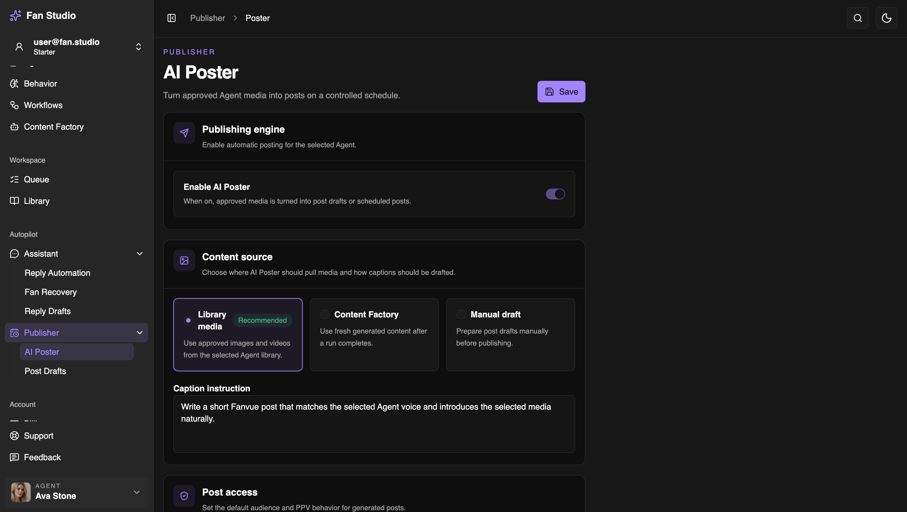
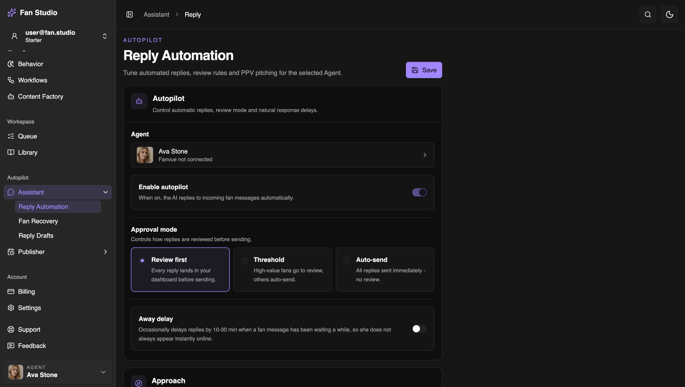
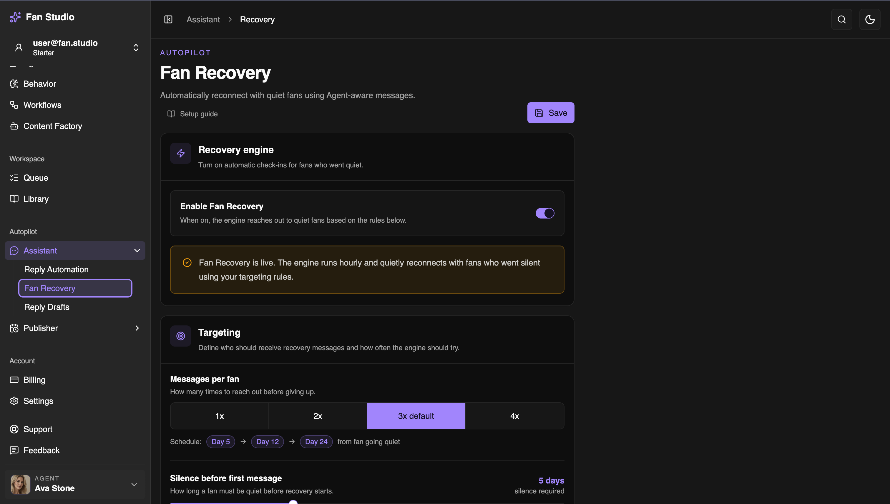

# Fanlab

A creator operations workspace for shaping an agent's identity, planning content and managing the work between an idea and a publishing schedule.

## One workspace for the production cycle

Agent profiles hold identity, appearance references and personality. Behavior settings define voice and communication style. Content Factory brings the agent, references, output mix and schedule together before a run enters the queue.

The queue makes individual tasks visible; the library gives finished media a place to be reviewed and reused. Publishing and audience tools cover post drafts, reply drafts, assistant workflows and audience recovery.

| Area | What it brings together |
| --- | --- |
| Agents | Creator profiles, reference images and identity details |
| Behavior | Voice, tone, communication preferences and boundaries |
| Content Factory | Production recipes, references, schedules and capacity estimates |
| Queue | Run and task details, status filters, retry and cancellation controls |
| Library | Searchable media, previews, agent filters and grouped outputs |
| Publishing and audience | Post planning, reply drafts, assistant and recovery workflows |

## Inside the workspace

Agent profiles and behavior

Content Factory, queue and library

Publishing and audience tools

## Technology

Vue 3, TypeScript, Vite, Pinia, shadcn-vue and Tailwind CSS. Python and FastAPI provide the API foundation.
